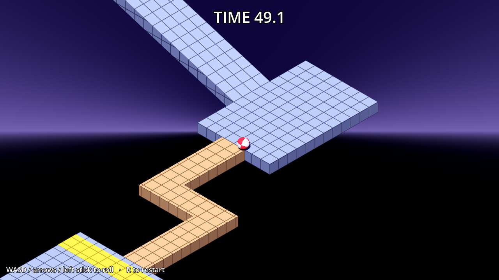

# Ball Madness

A Marble Madness-style game built with **Godot 4.7 (.NET / C#)**. Roll the ball down a series of isometric obstacle courses, each before its clock runs out. Desktop targets: Windows and Linux.



## Requirements

- [Godot 4.7 .NET edition](https://godotengine.org/download) (the "Godot Engine - .NET" build, not the standard one)
- [.NET 8 SDK](https://dotnet.microsoft.com/download/dotnet/8.0)

## Running

Open `project.godot` in the Godot .NET editor and press **F5**. Or from a terminal:

```sh
dotnet build
godot --path .
```

## Controls

| Action  | Keyboard        | Gamepad          |
|---------|-----------------|------------------|
| Roll    | WASD / arrows   | Left stick, D-pad |
| Rotate camera | Hold right mouse button and move the mouse | |
| Zoom    | Mouse wheel     |                  |
| Restart level | R         | Start            |
| Continue (next level / retry) | Enter / Space | A |

Movement is relative to the camera: "up" always rolls the ball towards the top of the screen, however the camera is turned.

## Levels

The game plays every `levels/levelNN.tscn` in number order (`level01` up to `level99`; there is no list to edit, adding the file is enough). Reach the goal and the level-complete screen shows your time; press Enter for the next level. Run out of time and Enter or R retries the same level. After the last level the game-complete screen shows your total time and falls, and Enter starts again from level 1.

To make a level, copy `levels/level01.tscn` and keep its structure:

- The root is a `Node3D` with `Scripts/LevelInfo.cs` attached. Its exports set `DisplayName`, `TimeLimit` (seconds) and `KillHeight` (falling below it counts as a fall).
- A `Spawn` marker where the ball starts.
- `Area3D` nodes in the `checkpoint` and `goal` groups.
- A `Route` node of `Marker3D` waypoints for the autopilot.

Everything else is plain geometry, so the course can be edited directly in the Godot editor.

To jump straight to a level: `godot --path . -- --level 5`.

### Level 1: First Descent

Start high on the blue pad and work your way down: a wide ramp, a narrow ramp with no rails, a zig-zag bridge, then a slalom ramp with posts before the green goal pad. You have 60 seconds. Fall off and you respawn at the last yellow checkpoint, but the clock keeps running while you fall.

### Level 8: Piston Alley

A thin walkway with three pistons that shoot out across it from alternating sides. Wait for a piston to pull back, then go. After that, a narrow ramp with no rails and a zig-zag of beams only 1.4 m wide. 45 seconds.

### Level 9: Sweeper Works

A turntable with a long sweeper bar (follow it round, don't meet it head on), a bridge that slides in and out of a gap, a wiper bar that swings across the next bridge, a steep narrow ramp, and one more sliding bridge before the goal. 45 seconds.

### Level 10: The Gauntlet

The finale: faster pistons on a 2.5 m walkway, a sliding bridge, an arena guarded by two black steelies that chase you and try to knock you off, a fast turntable sweeper, and thin beams to the finish. 48 seconds.

## Project layout

```
Scenes/Main.tscn    Game root: environment, light, ball, camera rig, HUD (the level is loaded at runtime)
Scenes/Ball.tscn    The player ball (RigidBody3D)
levels/levelNN.tscn The courses (CSG boxes with collision), checkpoints, goal, autopilot route
Scripts/Game.cs     Loads the level; countdown, timer, falling/respawn, checkpoints, goal, end screens
Scripts/Levels.cs   Finds the levels, tracks which one is being played and the run's total time
Scripts/LevelInfo.cs Per-level settings on the level's root: name, time limit, kill height
Scripts/Ball.cs     Camera-relative rolling controls
Scripts/CameraRig.cs Isometric orthographic follow camera, right-drag to orbit, wheel to zoom
Scripts/AutoPilot.cs Smoke test that drives the course by itself
Scripts/Hazards/    Moving obstacles: Mover (pistons, sliding bridges), Spinner (sweeper bars), Chaser (enemy steelies)
Shaders/            World-space grid for the course, two-tone ball
```

Tuning knobs are exported properties: `TimeLimit` and `KillHeight` on each level's root, `RollTorque`, `PushForce`, `AirControl` and `MaxSpeed` on the ball, and the camera's starting orthographic `size` on `CameraRig/Camera3D` (plus `MinZoom`, `MaxZoom`, `ZoomStep` and `MouseSensitivity` on `CameraRig`).

## Smoke test

The autopilot drives the ball along the level's route and exits with code 0 when it reaches the goal (1 if time runs out). It runs headless, so it works in CI:

```sh
dotnet build
godot --headless --path . -- --autopilot             # level 1
godot --headless --path . -- --level 5 --autopilot   # one level
godot --headless --path . -- --autopilot --all       # every level in a row
```

For levels with timed hazards, a `Route` waypoint can tell the autopilot to wait: give the marker the metadata `wait_area` (a NodePath to an `Area3D` over the danger zone) and `wait_for` (`clear` or `occupied`). The pilot holds at the previous waypoint and sets off the moment the area empties of moving bodies (a piston pulls back) or a moving body arrives in it (a sliding bridge fills the gap). A `speed` metadata value caps the pilot's speed on the way to that waypoint, for thin beams.
